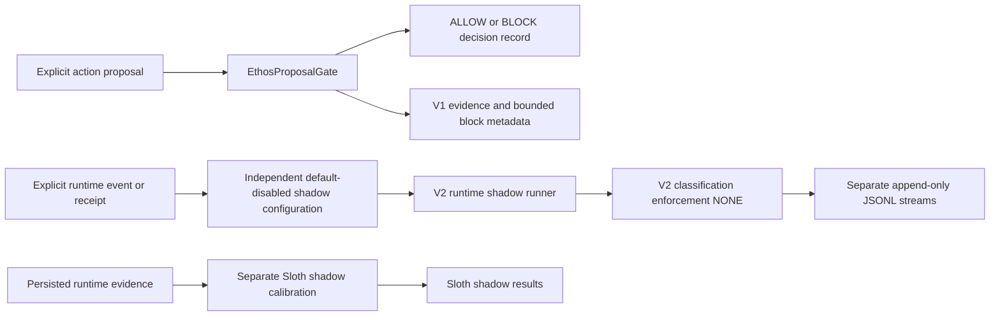
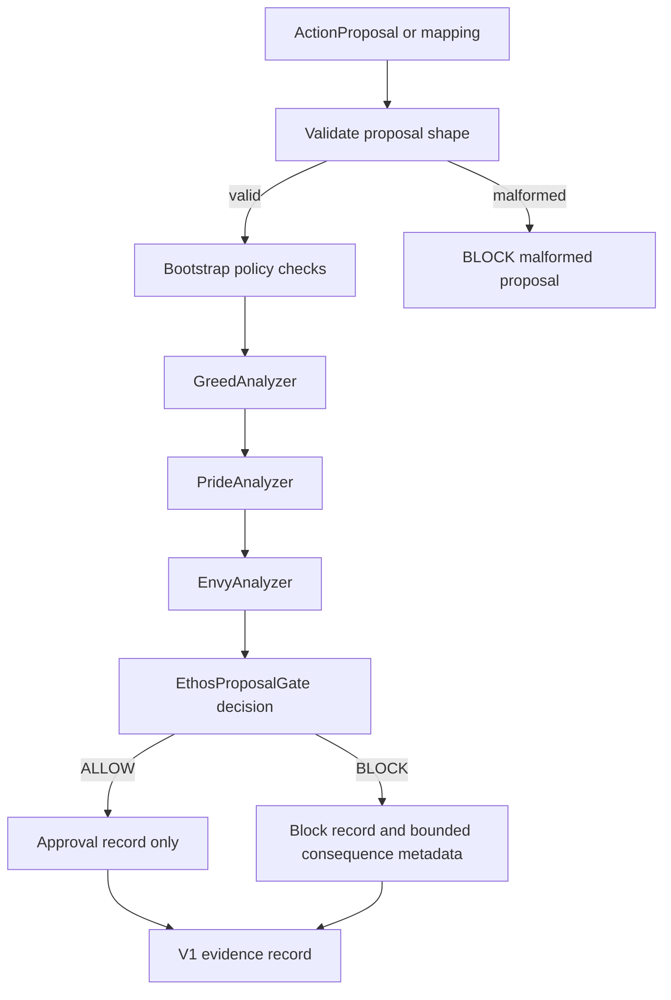
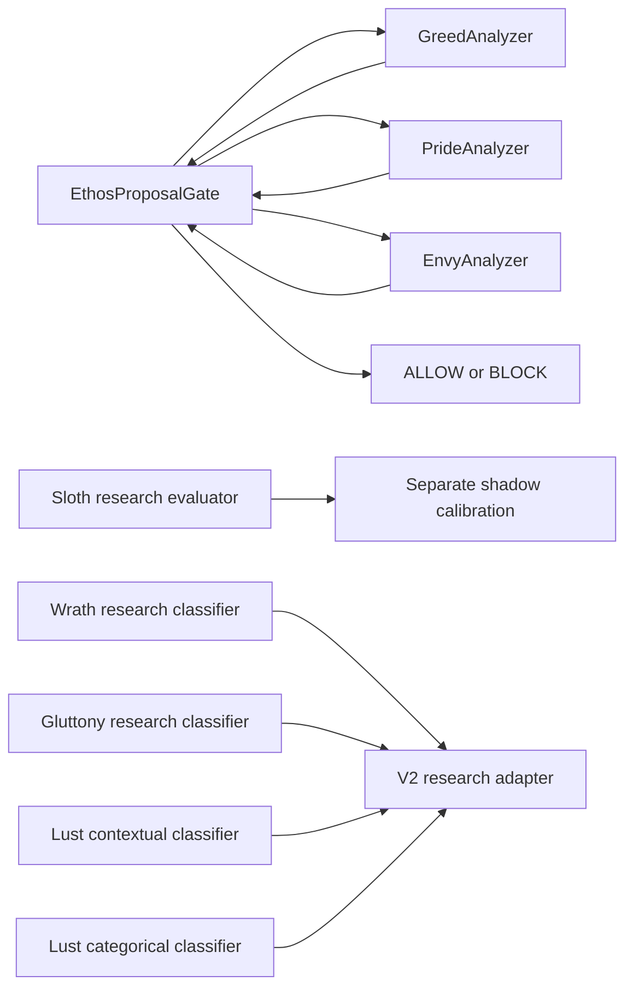
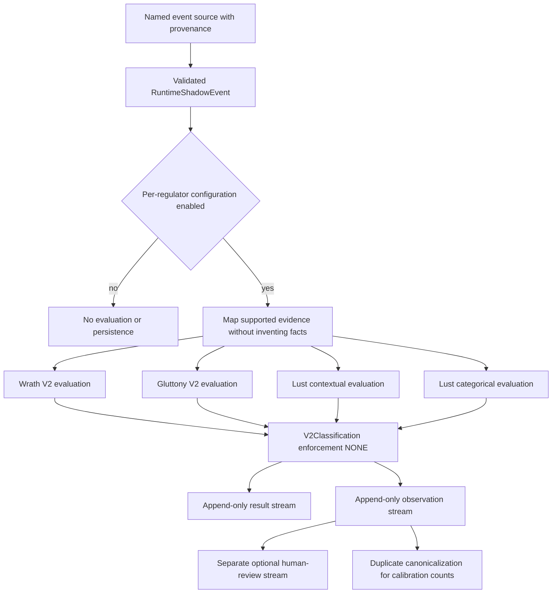
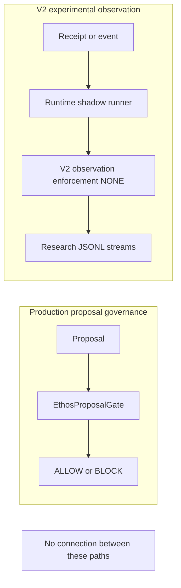

# ETHOS++ Architecture Guide

This guide describes the published ETHOS++ boundaries from the current source
and publication records. It does not expand the authority of any regulator or
turn experimental observations into production decisions.

## High-level system boundary

The V1 and V2 paths are deliberately separate. The V1 Gate is the production
proposal-decision path. V2 observation produces research records only, and the
frozen Sloth subsystem remains a separate shadow/calibration path.

## V1 ProposalGate decision flow

`EthosProposalGate.inspect` evaluates Greed, Pride, and Envy after proposal
validation and bootstrap checks. Its output is a decision record. An `ALLOW`
does not authorize an executor or perform the proposed action.

## Production-regulator relationships

Only Greed, Pride, and Envy participate in the V1 Gate’s regulator decision
path. Sloth is shadow/calibration only. Wrath, Gluttony, and the two Lust
branches are research classifiers reached through V2 adapters, not V1
production regulators.

## V2 shadow-only research pipeline

The generic V2 configuration defaults to disabled for Wrath, Gluttony, and
Lust. An enabled stream accepts only a validated source event and preserves
provenance, evidence references, and missing-evidence conditions. Incomplete
evidence is not filled with invented facts. Both Lust branches can be evaluated
when their respective inputs are supplied. Every V2 result has
`enforcement=NONE`.

## Enforcement and observation separation

No cross-path arrow is drawn because no such integration exists. The V2 generic
observation and runner modules are designed without ProposalGate,
production-regulator, executor, Scar/consequence-service, or frozen-Sloth
module imports. Experimental observations cannot become production decisions
through these components.

## Evidence provenance and publication boundary

V2 observation distinguishes `REAL_RUNTIME`, `SYNTHETIC_FIXTURE`, and
`REPLAY`. A provenance label does not create evidence that was not observed.
The published Phase 5G and 5H datasets are synthetic fixtures. Runtime JSONL
records, local telemetry, authorizations, receipts, target files, databases,
and live-model outputs are excluded from the public repository.

For source-level details, see [ETHOS_PUBLICATION_ARCHITECTURE.md](ETHOS_PUBLICATION_ARCHITECTURE.md),
the [documentation index](DOCUMENTATION_INDEX.md), and the
[publication audit](ETHOS_GITHUB_PUBLICATION_AUDIT.md).
